<div align="center">

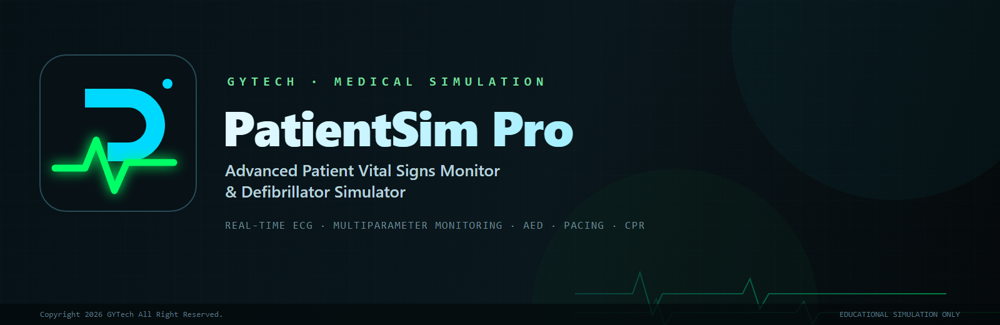

# GYTech PatientSim Pro

**Advanced Patient Vital Signs Monitor & Defibrillator Simulator**

_Bringing Advanced Patient Monitoring and Emergency Response Simulation to the Browser._

[](#repository-status)
[](LICENSE)
[](docs/ARCHITECTURE.md)
[](#technology-stack)
[](#medical-disclaimer)

**Copyright 2026 GYTech All Right Reserved.**

**License status: PENDING OWNER APPROVAL — this repository is not yet published as open source.**

</div>

> [!IMPORTANT]
> **This application is an educational software simulation only. It is not a medical device, is not clinically validated, does not replace professional training, and must not be used for patient diagnosis, treatment, or actual emergency medical decisions.**

> [!NOTE]
> GitHub-native badges for CI, issues, pull requests, contributors, repository
> size, and last commit are intentionally omitted until the official GYTech
> repository is created and the prepared workflows have run on GitHub. Adding
> them before that would fabricate repository state. See
> [Repository status](#repository-status) and
> [docs/GITHUB_REPOSITORY_SETUP.md](docs/GITHUB_REPOSITORY_SETUP.md).

---

## Contents

- [Repository status](#repository-status)
- [Application screenshots](#application-screenshots)
- [Project overview](#project-overview)
- [Key features](#key-features)
- [Advanced system design](#advanced-system-design)
- [Technology stack](#technology-stack)
- [System requirements](#system-requirements)
- [Desktop application](#desktop-application)
- [Installation](#installation)
- [Quick start](#quick-start)
- [Simulation capabilities](#simulation-capabilities)
- [Defibrillator system](#defibrillator-system)
- [Roadmap](#roadmap)
- [Known limitations](#known-limitations)
- [Testing and validation](#testing-and-validation)
- [Contributing](#contributing)
- [Security](#security)
- [License](#license)
- [Medical disclaimer](#medical-disclaimer)
- [Acknowledgments](#acknowledgments)
- [Copyright](#copyright)

---

## Repository status

| Item | Current status |
|---|---|
| Project | GYTech PatientSim Pro |
| Full title | Advanced Patient Vital Signs Monitor & Defibrillator Simulator |
| Version | 1.0.0 release candidate |
| Owner / copyright holder | **GYTech** |
| Recommended repository | `GYTech-PatientSim-Pro` |
| GitHub organization URL | **Pending owner confirmation** |
| Homepage | **No verified deployment URL yet** |
| License | **PENDING OWNER APPROVAL** — see [LICENSE](LICENSE) |
| Open-source status | **Not yet open source** |
| Release | Prepared, **not published** |
| GitHub Actions | Configured, **not yet run on GitHub** |
| Desktop framework | **Electron 34.1.1** (documented Tauri fallback decision) |
| Windows desktop build | **BUILT** — EXE, MSI, Portable ZIP; install/uninstall smoke-tested |
| Linux desktop build | **CONFIGURED** — not built or tested on Windows host |
| macOS desktop build | **CONFIGURED** — not built or tested on Windows host |
| Code signing / notarisation | **NOT CONFIGURED / NOT CLAIMED** |
| Desktop live update channel | **BLOCKED** — official GitHub repository not configured |
| Browser verification | Chromium/Electron local automation completed |
| Cross-browser verification | Pending |
| Testing report | [TESTING_REPORT.md](TESTING_REPORT.md) |
| Independent audit | [PROJECT_AUDIT_REPORT.md](PROJECT_AUDIT_REPORT.md) |
| Release notes | [Draft v1.0.0 release notes](docs/RELEASE_NOTES_v1.0.0.md) — not published |
| Medical/regulatory status | Not a medical device; no certification claimed |

**Repository description:** A professional browser-based patient vital signs
monitor and defibrillator simulator featuring real-time ECG waveforms,
physiological simulation, multiparameter monitoring, alarms, AED, manual
defibrillation, synchronized cardioversion, pacing, and medical training
scenarios.

**Topics:** `patient-monitor` · `vital-signs` · `medical-simulation` · `ecg` ·
`ecg-monitor` · `defibrillator` · `aed-simulator` · `cardioversion` ·
`healthcare-technology` · `medical-education` · `javascript` · `html` · `css` ·
`simulation` · `gytech`

**Social preview:** [assets/branding/social-preview.png](assets/branding/social-preview.png)

---

## Application screenshots

All screenshots were captured from the running application with Chromium/Electron
automation. They are genuine interface captures, not stock images or generated
mockups. Demo data is fictional.

### Main monitoring workstation

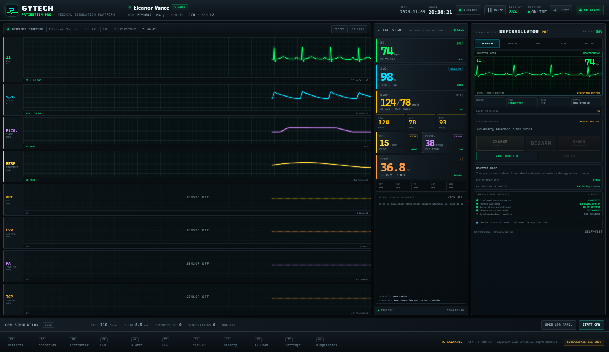

### Real-time ECG and 12-lead education

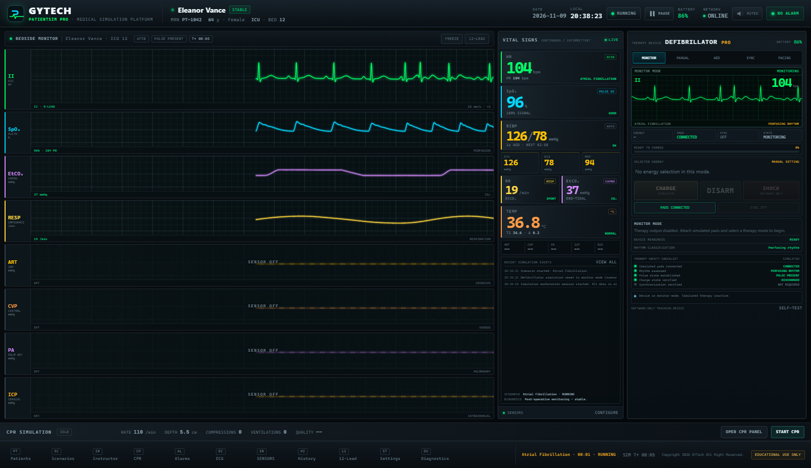

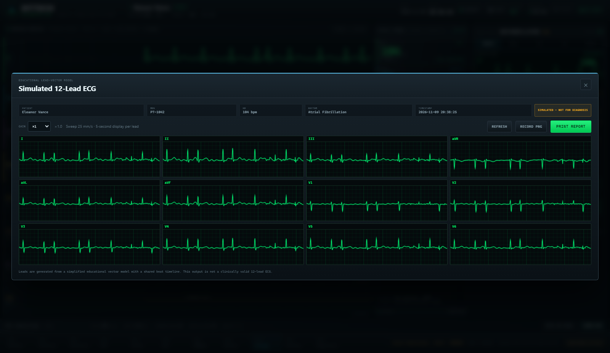

### SpO₂, capnography, and vital signs

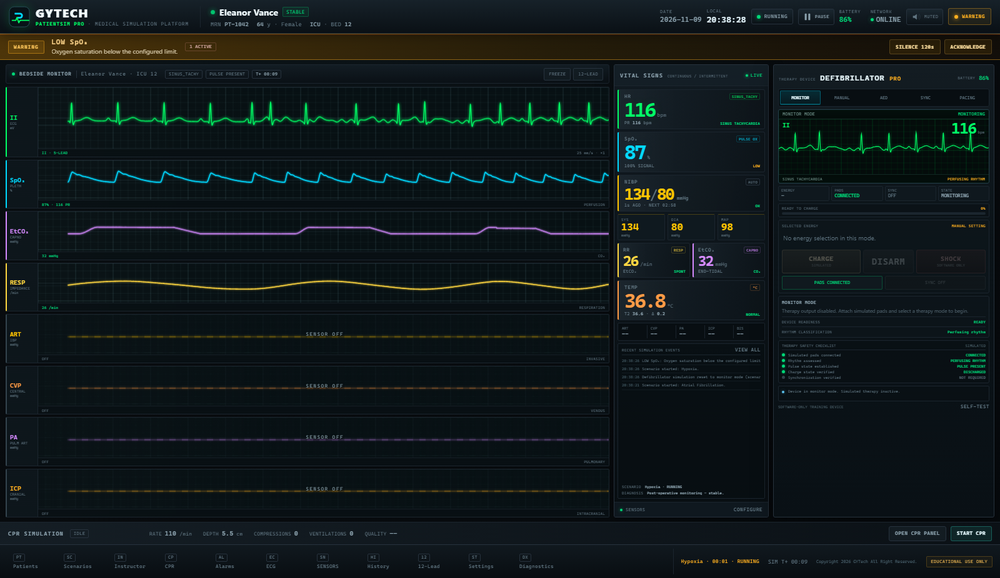

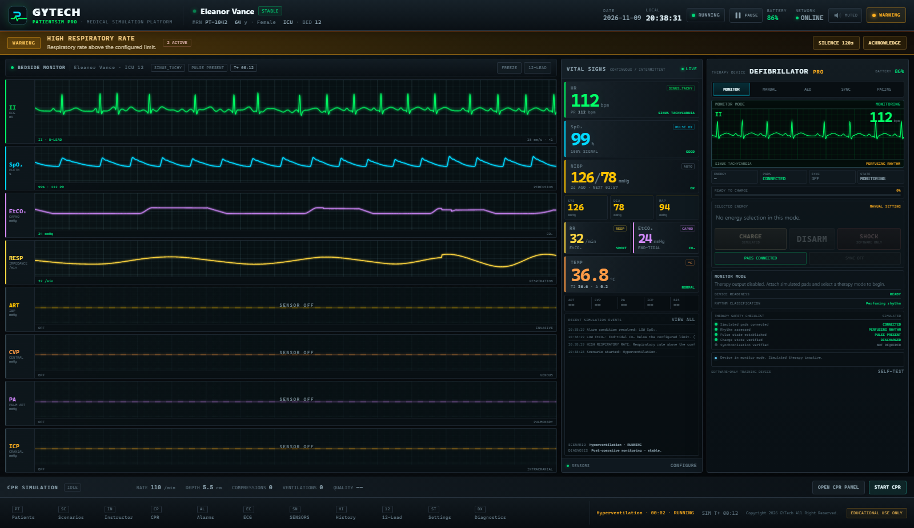

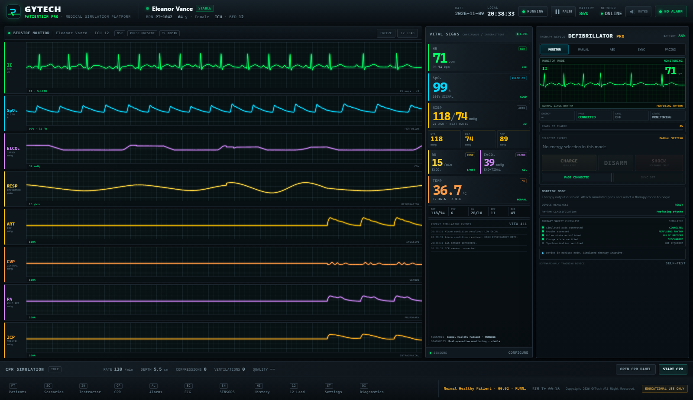

### Alarms and emergency therapy simulation

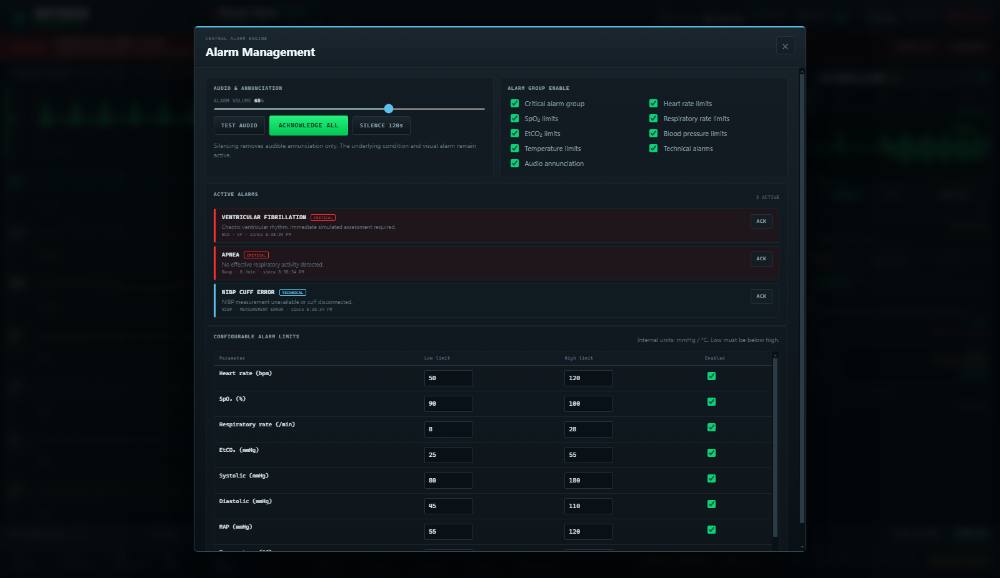

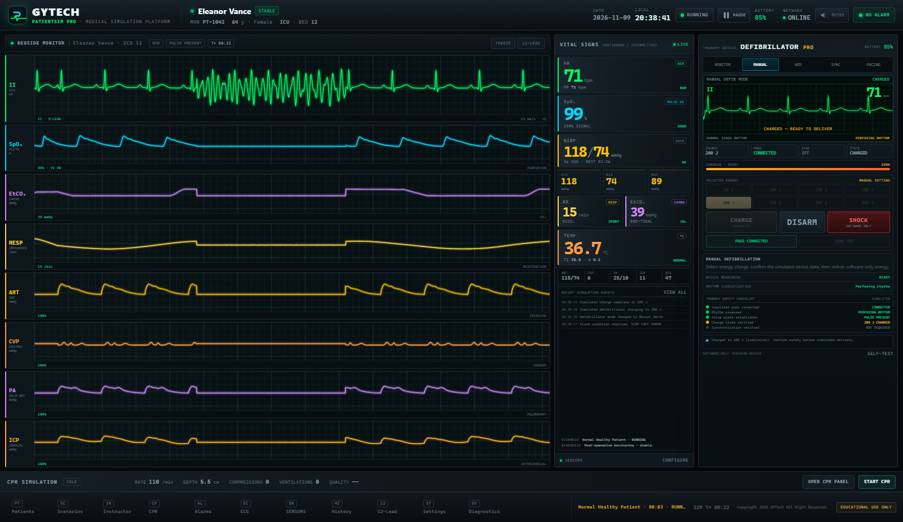

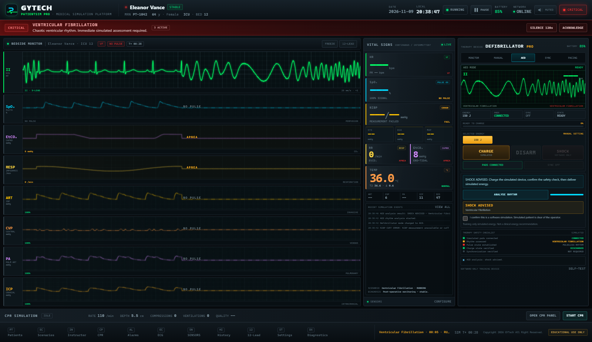

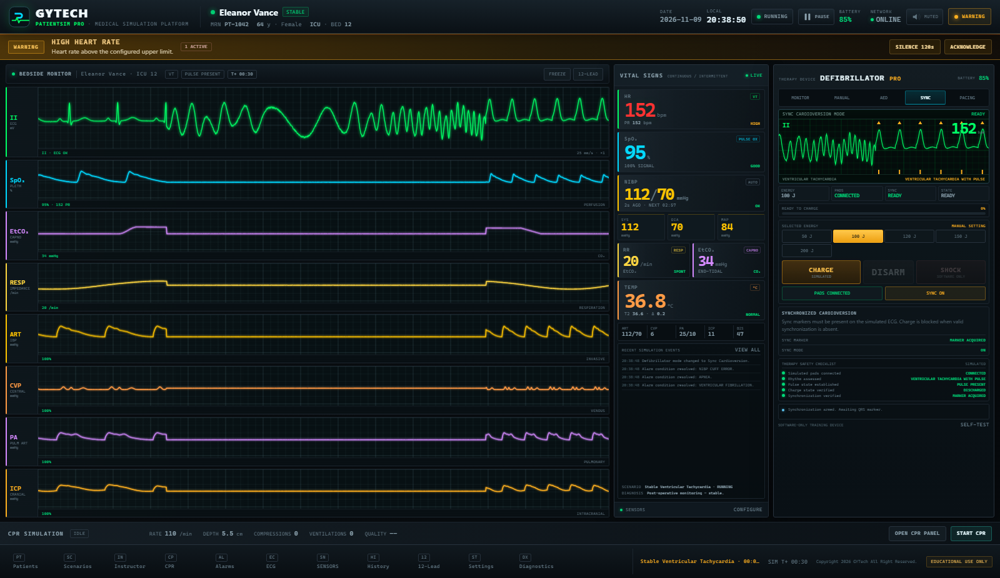

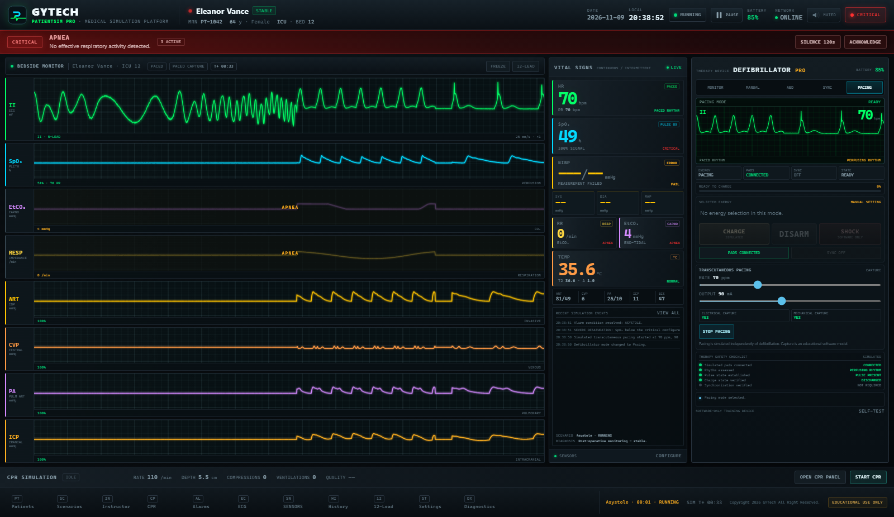

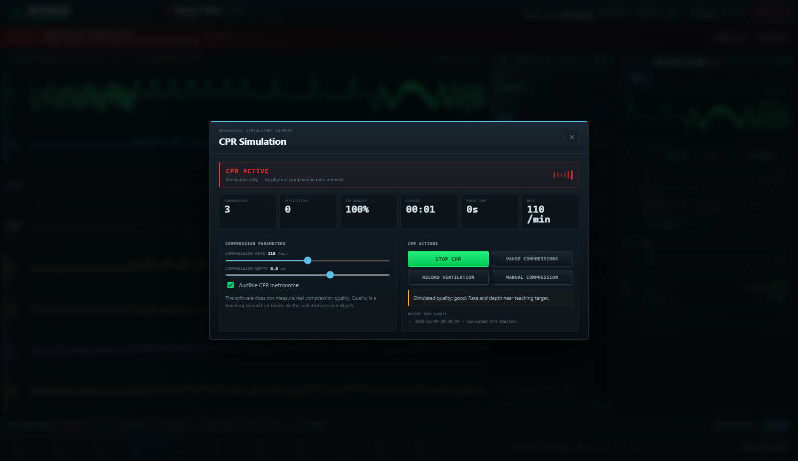

### Patient and simulation workflows

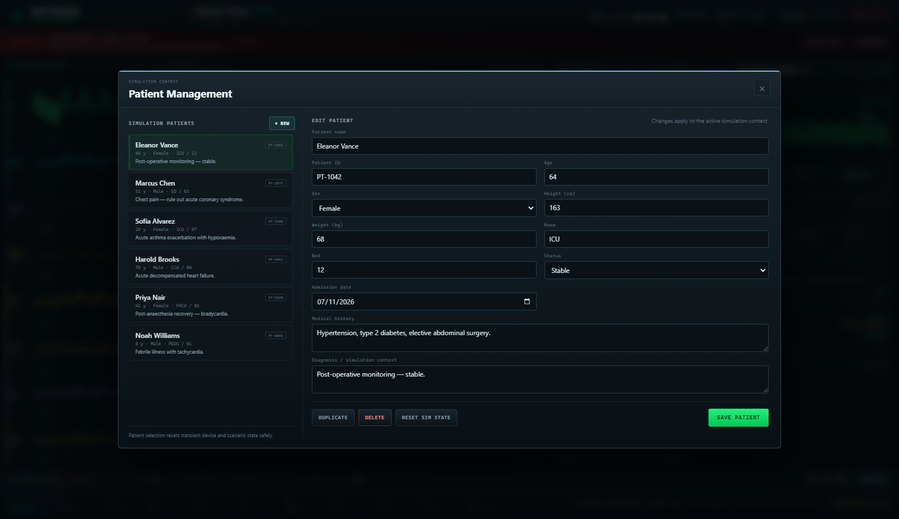

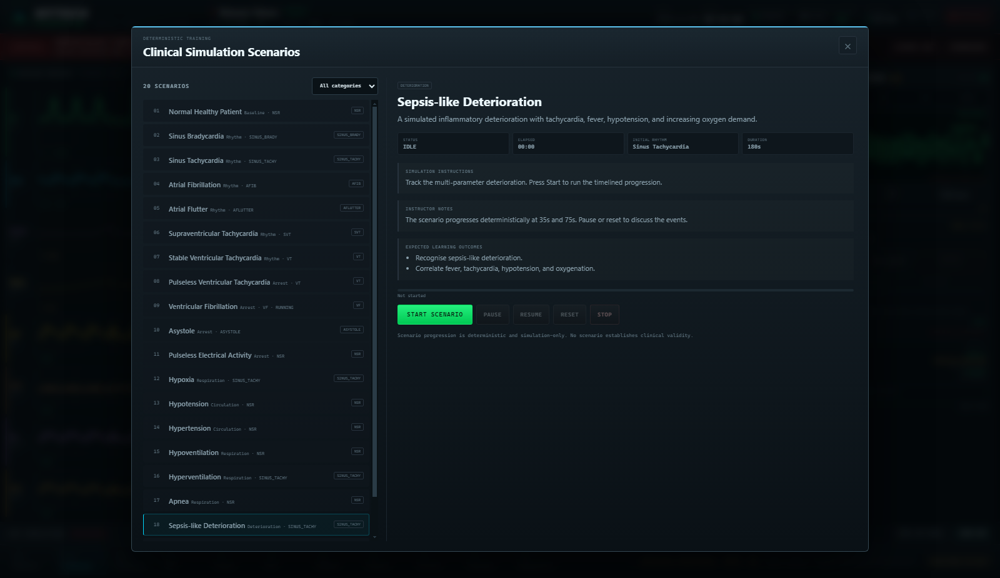

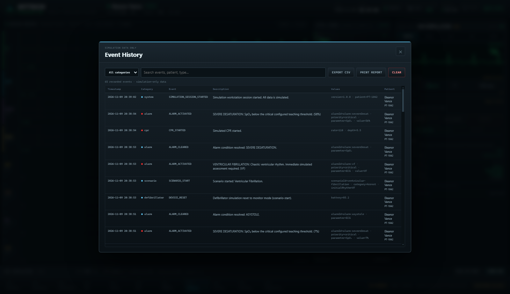

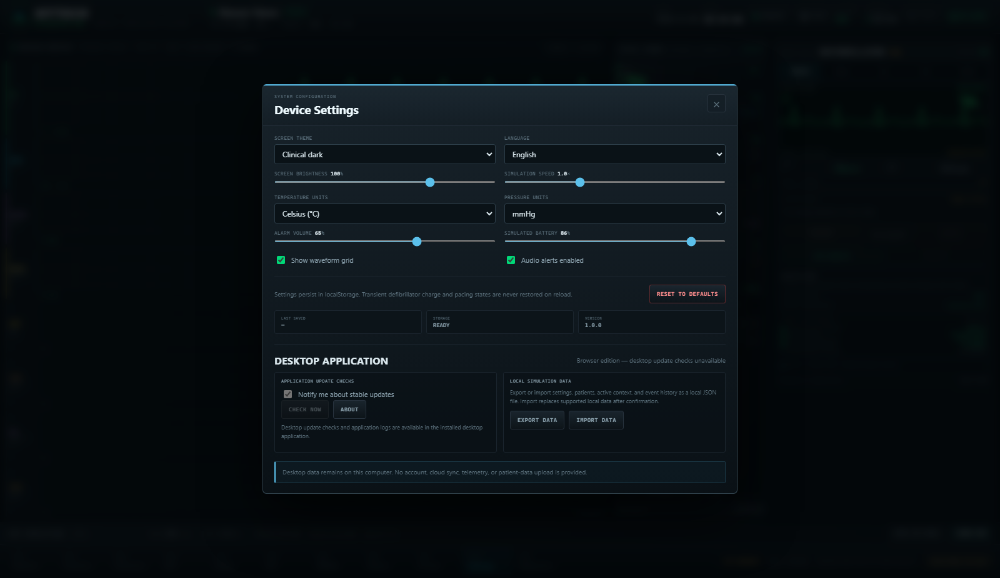

Capture method and full state descriptions:
[docs/SCREENSHOT_GUIDE.md](docs/SCREENSHOT_GUIDE.md).

---

## Project overview

GYTech PatientSim Pro is a browser-based multiparameter monitoring and emergency
response simulator for education, demonstration, and interaction evaluation. It
combines a realistic bedside-monitor surface with a software-only professional
defibrillator simulation.

### The problem it addresses

Medical simulation software can be expensive, hardware-bound, or visually
disconnected from real monitoring workflows. This project explores whether a
browser-only simulation can provide:

- coherent physiological relationships rather than unrelated random numbers,
- live parameterized waveforms rather than static images,
- explicit safety interlocks around simulated therapy,
- realistic workflow sequencing for monitoring, alarms, AED, manual therapy,
  pacing, and CPR,
- reproducible teaching scenarios without clinical risk.

### Who it is designed for

- Medical and nursing educators preparing demonstrations.
- Simulation technicians exploring interaction design.
- Software engineers reviewing physiological simulation architecture.
- Students practising monitor and defibrillator workflow concepts under
  supervision.
- Open-source contributors interested in educational health technology.

### Design principles

1. **Function over decoration** — controls operate on the shared simulation state.
2. **Physiological consistency** — pulse, perfusion, rhythm, oxygenation, and
   pressure remain connected.
3. **Safety boundaries** — software-only therapy, explicit disclaimers, no
   physical output, no automatic ROSC.
4. **Unavailable means unavailable** — disconnected sensors do not fabricate
   valid measurements.
5. **Honest documentation** — implemented, partial, and planned features are
   separated.
6. **No clinical claims** — the project never certifies clinical validity.

---

## Key features

Status legend: **Implemented** · **Partial** · **Planned**

### A. Patient Management — Implemented

- Six fictional sample patients.
- Create, edit, duplicate, select, delete, and reset patient profiles.
- Patient ID, age, sex, height, weight, room, bed, status, admission date,
  history, and diagnosis fields.
- Safe reset of transient device and scenario state when switching patients.

### B. Multiparameter Monitoring — Implemented

- ECG/HR, PR, SpO₂, NIBP, SYS, DIA, MAP, RR, EtCO₂, dual temperature, ART, CVP,
  PA, ICP, and BIS.
- Sensor connection and signal-quality states.
- Unit-aware display for mmHg/kPa and °C/°F.
- Recent-event context in the monitor rail.

### C. Real-Time ECG — Implemented (multi-lead strip display partial)

- Parameterized P-QRS-ST-T synthesis.
- Fourteen rhythm models.
- Adjustable gain, sweep speed, noise, motion artifact, baseline wander, and
  lead-off.
- Single canvas render loop with stable delta-time behavior.
- 3-/5-/12-lead selector and a full educational 12-lead view. **Partial:** the
  bedside monitor currently shows one selected lead at a time; simultaneous
  multi-lead strips for 3-/5-lead mode are not yet implemented.

### D. 12-Lead ECG — Implemented (educational approximation)

- Twelve simultaneous educational lead displays sharing one beat timeline.
- Approximate lead-specific morphology.
- Gain control, PNG capture, print report, patient information, and timestamp.
- Explicitly not clinically valid or diagnostic.

### E. SpO₂ Monitoring — Implemented

- SpO₂, pulse rate, pleth waveform, signal quality, sensor-off state, no-pulse
  state, low-perfusion behavior, and artifact synthesis.

### F. Respiratory Monitoring — Implemented

- Respiratory waveform and rate.
- Normal, rapid, shallow, deep, agonal, irregular, and apneic patterns.
- Sensor disconnection and apnea alarms.

### G. Capnography — Implemented

- EtCO₂ numeric display and capnogram.
- Normal, hypoventilation, hyperventilation, apnea, rebreathing, obstruction,
  and disconnected-line patterns.
- Derived respiratory rate context.

### H. Blood Pressure Monitoring — Implemented

- Intermittent NIBP with automatic interval, manual measurement, countdown,
  failure state, and timestamp.
- ART, CVP, PA, and ICP invasive pressure waveforms and values.
- MAP calculation and unit conversion.

### I. Temperature Monitoring — Implemented

- Temperature 1 and optional Temperature 2.
- Temperature difference and °C/°F conversion.
- Probe-off state and high/low temperature alarms.

### J. Alarm Management — Implemented

- Critical, warning, and technical priorities.
- Configurable limits and group toggles.
- Audible annunciation through Web Audio.
- Acknowledge, silence, 45-second escalation, active-alarm list, and history.
- Silence does not clear visual or underlying conditions.

### K. Manual Defibrillator — Implemented (software only)

- Monitor, manual, AED, sync, and pacing modes.
- Energy selection, charge, disarm, and simulated shock.
- Pads, battery, charge, and post-event interlocks.
- No physical electrical output.

### L. AED Simulation — Implemented

- Attach pads, analyse, display analysis progress, shock/no-shock
  recommendation, charge when advised, safety confirmation, simulated delivery,
  and post-event reassessment.
- Stable perfusing VT is not treated as an AED shock indication.
- No automatic ROSC after a simulated shock.

### M. Synchronized Cardioversion — Partial / educational

- Dedicated SYNC mode with simulated R-wave markers and sync eligibility.
- Charge is blocked without valid simulated synchronization.
- **Limitation:** the simulator validates simulated eligibility rather than
  providing hardware-timed R-wave output. This is documented in the guides and
  roadmap.

### N. Transcutaneous Pacing — Implemented (simplified educational)

- Rate and output controls, electrical and mechanical capture states, and
  failure-to-capture simulation.
- Pacing is deliberately separate from defibrillation.
- **Limitation:** failure-to-capture does not fully superimpose every intrinsic
  rhythm.

### O. CPR Simulation — Implemented

- Start/stop, pause/resume, rate, depth, compression and ventilation counters,
  simulated quality, pause timing, optional metronome, and partial circulation.
- No physical compression measurement.
- No automatic ROSC.

### P. Emergency Scenarios — Implemented

- Twenty deterministic scenarios.
- Initial state, instructions, instructor notes, outcomes, progression,
  pause/resume/reset, and explicit ROSC.
- Full table below.

### Q. Event History — Implemented

- Timestamped patient, rhythm, alarm, sensor, measurement, defibrillator, pacing,
  CPR, scenario, recovery, ECG, settings, and system events.
- Filtering, search, values display, and clear action.
- Browser-local persistence.

### R. Data Export — Implemented

- CSV event-history export.
- PNG 12-lead capture.
- Printable simulation event report and 12-lead report.
- Explicit simulation-only labelling.

### S. System Configuration — Implemented (language coverage partial)

- Themes, brightness, units, simulation speed, audio volume, battery simulation,
  grid, and reset defaults.
- English and Spanish core-navigation labels. Full-page localization is partial
  and planned.

### Additional safety-oriented behavior

- Simulation-only status visible in the application.
- No external network integration or telemetry.
- No real patient data or device interfaces.
- CSP and referrer-policy meta tags.
- Defibrillator FSM with invalid-transition guards.
- Pacing and defibrillation kept separate.
- Explicit disclaimers across UI and documentation.

---

## Advanced system design

Detailed diagrams and explanations: [docs/ARCHITECTURE.md](docs/ARCHITECTURE.md).

### 1. System architecture

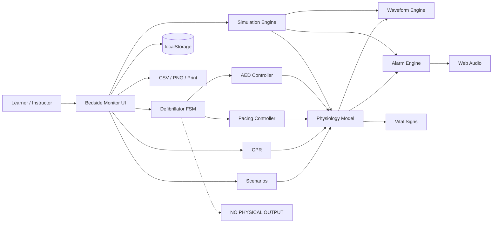

### 2. Application modules

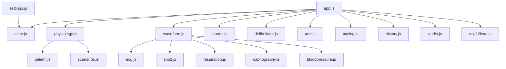

### 3. Patient physiology data flow

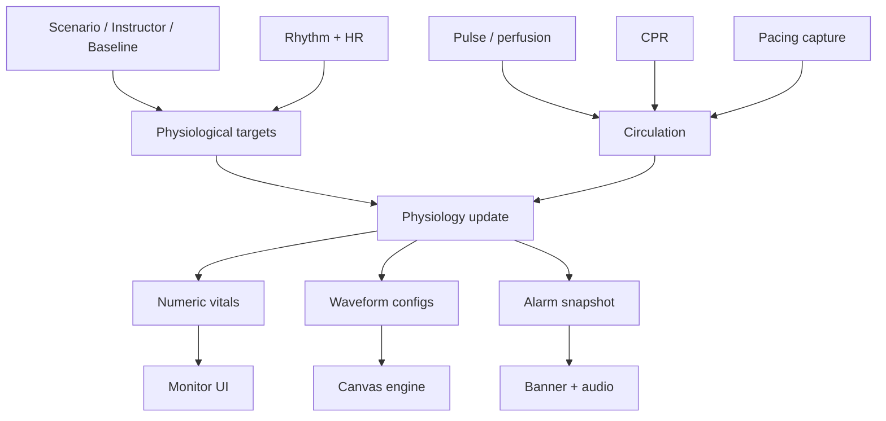

### 4. ECG rendering pipeline

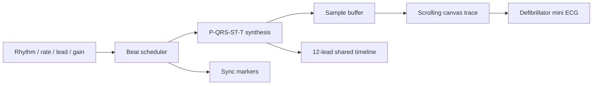

### 5. Alarm processing

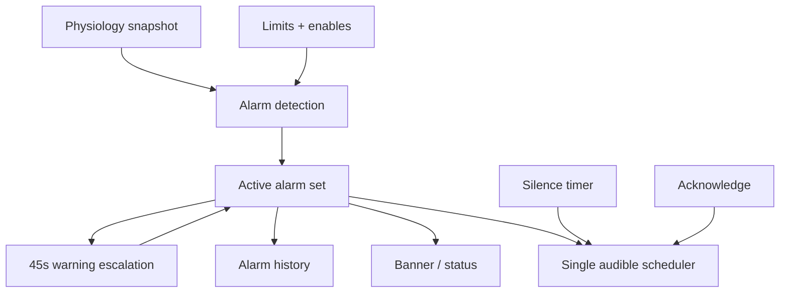

### 6. Defibrillator state machine

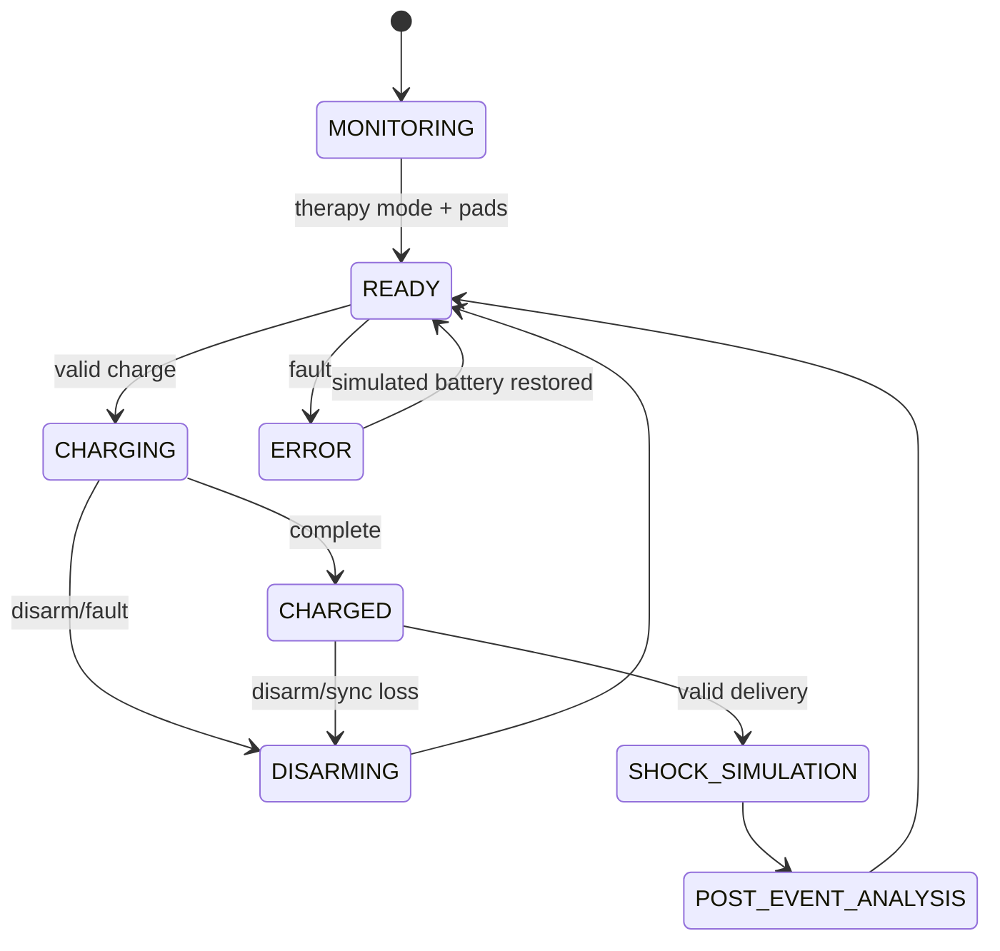

### 7. AED workflow

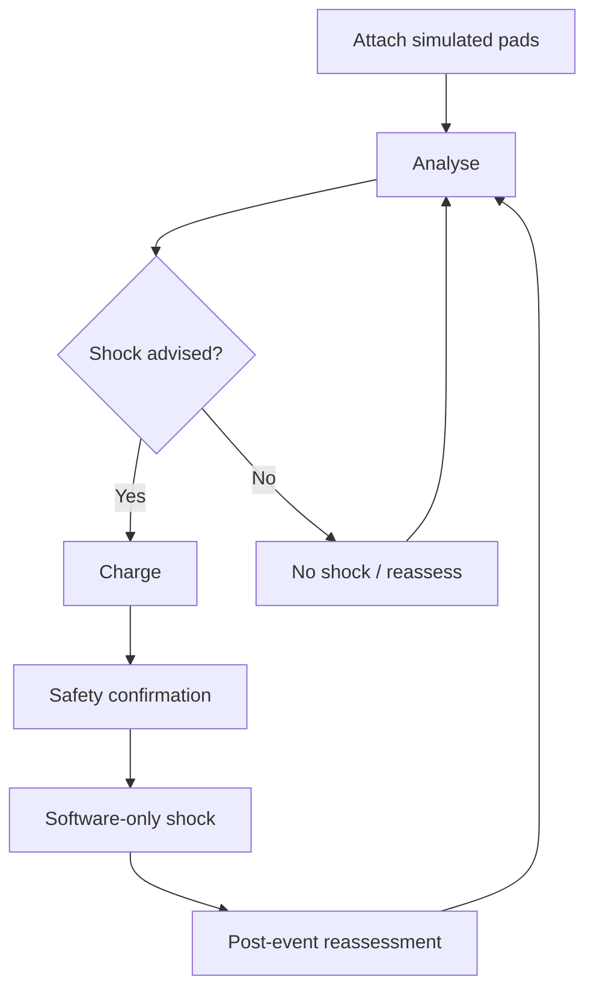

### 8. Scenario workflow

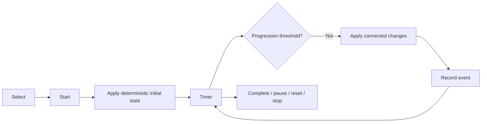

### 9. Persistence architecture

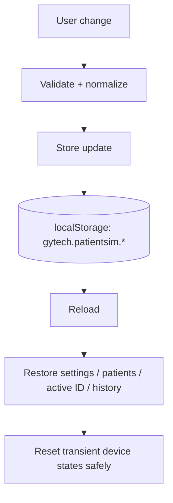

---

## Technology stack

Everything below is actually implemented; no framework or runtime dependency is
claimed.

| Technology | Use |
|---|---|
| HTML5 | Application structure and accessible controls |
| CSS3 | Responsive layout, themes, CSS Grid/Flexbox |
| JavaScript ES6+ modules | Application logic and module boundaries |
| Canvas 2D | Live waveform rendering and DPR-aware resizing |
| SVG | Original GYTech logo, banner, and interface icon |
| Web Audio API | Alarm, charge, shock, and CPR metronome synthesis |
| Web Speech API | Optional AED voice prompts, where the browser supports it |
| localStorage | Settings, patient profiles, active patient, event history |
| `requestAnimationFrame` | One stable simulation/render loop |
| `setInterval` | Bounded audio schedulers and periodic update-check scheduling |
| Electron 34.1.1 | Native desktop runtime, bundled with installed/portable builds |
| electron-builder 26.18.1 | Windows EXE/MSI/portable packaging and cross-platform build configuration |
| Node.js 18+ | Development static server, validation, tests, and build tooling |
| GitHub Actions | Browser, quality, security, Pages, and desktop-release workflows; not yet run on GitHub |

No React, Vue, Angular, jQuery, Tailwind, Bootstrap, CDN assets, external web
fonts, stock photography, or manufacturer assets are used. There are no runtime
npm dependencies in the browser application; installed desktop builds bundle the
Electron/Chromium runtime and include its third-party notices.

---

## System requirements

### Browser

- Current Chromium-based browser (Chrome/Edge) — primary verified environment.
- Firefox — expected for standard features; automated cross-browser verification
  is not yet complete.
- Safari — not verified.
- JavaScript modules, Canvas 2D, CSS Grid/Flexbox, Web Audio, and localStorage
  required.
- Web Speech is optional; visible AED guidance remains available without it.

### Recommended display

- 1920×1080 or 1600×900 recommended.
- 1366×768 and 1280×720 supported.
- Tablet layout reflows the defibrillator below the monitor.
- Very narrow layouts are not a primary target.

### Local execution

- A local HTTP server is required for browser development; `file://` is not
  supported for ES modules.
- Node.js 18+ and npm are recommended for the bundled static server, tests, and
  desktop builds.
- Python 3 can serve static files as an alternative.
- The application code makes no remote requests after loading its local assets.
  Optional browser/OS speech synthesis may use platform-provided processing; see
  [PRIVACY.md](PRIVACY.md).

### Desktop runtime

- Windows 10/11 x64 — verified build and launch on Windows 11 x64.
- Linux x64 — AppImage/DEB/RPM configured; not verified on this host.
- macOS x64/ARM64 — DMG configured; not verified on this host.
- The desktop package bundles Electron; Node.js is **not** required by end users.
- No separate WebView runtime is required for the Electron build.

---

## Desktop application

GYTech PatientSim Pro is packaged as a native **Electron 34.1.1** desktop
application. Tauri 2.x was evaluated first, but the documented fallback was
selected because the Windows host has no Rust/MSVC toolchain and the existing
simulation is already verified against Electron's Chromium renderer. This avoids
shipping a different, unverified WebView engine on every operating system.
The full assessment and security architecture are in
[docs/DESKTOP_APPLICATION.md](docs/DESKTOP_APPLICATION.md).

### Supported platforms and actual status

| Platform | Target | Current status |
|---|---|---|
| Windows 10/11 x64 | EXE, MSI, Portable ZIP | **BUILT** and **TESTED** on Windows 11 x64 |
| Linux x64 | AppImage, DEB, RPM | **CONFIGURED**; not built or tested on this host |
| macOS x64 / ARM64 | DMG | **CONFIGURED**; not built or tested on this host |

Do not interpret CI configuration as proof that Linux or macOS packages work.
Only the Windows artefacts listed below were actually produced and launched.

### Download

> **No public download URL or GitHub Release currently exists.** These files are
> produced locally by the build and are not published. The owner must approve the
> license, repository URL, contacts, signing, and release before any public
> download link is added.

Locally built Windows artefacts, when present, are in `release/`:

| Package | Expected file | Status |
|---|---|---|
| Assisted EXE installer | `GYTech-PatientSim-Pro-Setup-v1.0.0.exe` | **BUILT** |
| MSI package | `GYTech-PatientSim-Pro-x64-v1.0.0.msi` | **BUILT** |
| Portable ZIP | `GYTech-PatientSim-Pro-Portable-v1.0.0.zip` | **BUILT** |
| Checksums | `SHA256SUMS.txt` | Generated by `npm run desktop:checksums` |

The installers are **unsigned**. Windows SmartScreen may warn. No code-signing
certificate or Apple notarisation is configured or claimed.

### Install on Windows

1. Run `GYTech-PatientSim-Pro-Setup-v1.0.0.exe` and follow the assisted installer,
   or install the MSI.
2. Choose the installation directory if using the EXE installer.
3. The installer creates a Start Menu shortcut and an optional Desktop shortcut.
4. Launch **GYTech PatientSim Pro** from the Start Menu.
5. Use the uninstaller in Windows Apps & Features or the installation folder to
   remove the application.

The MSI is intended for standard Windows Installer deployment. MSI and EXE
clean-install/uninstall operations were smoke-tested. An NSIS 1.0.0 → synthetic
1.0.1 upgrade was also executed locally and reported version 1.0.1; the synthetic
test build was not released. MSI cross-version upgrade was not executed.

### Portable version

1. Extract the complete `GYTech-PatientSim-Pro-Portable-v1.0.0.zip` to a folder.
2. Run `GYTech PatientSim Pro.exe` from the extracted folder.
3. No installer or administrator permission is required.
4. Portable mode still stores local data under
   `%APPDATA%\GYTech PatientSim Pro`, not inside the extracted folder.
5. Removing the extracted folder does not remove local data. See
   [INSTALLATION.md](INSTALLATION.md) for cleanup and export instructions.

### Updating

The desktop app implements **Notify Then Download** only:

- It can check the official stable GitHub Release channel when the owner
  configures `desktop/update-config.json`.
- It shows installed and latest versions, a release summary, and buttons for
  **Download Update**, **View Release Notes**, **Remind Me Later**, and
  **Dismiss**.
- Download opens the official GitHub Release page in the system browser.
- It never downloads, executes, or installs an update silently.
- Network failure does not prevent the simulator from launching.

**Current limitation:** the official repository is not configured. The app
therefore reports that update checks are unavailable and performs no fabricated
release check. See [docs/UPDATE_SYSTEM.md](docs/UPDATE_SYSTEM.md).

### Offline functionality

All simulation features, waveforms, alarms, scenarios, local settings, and local
data tools use bundled assets and work without internet. Only the optional update
check needs the network, and it is disabled until configured. The packaged
renderer has no remote runtime assets.

### Local data

On Windows, Electron stores local simulation data under:

```text
%APPDATA%\GYTech PatientSim Pro
```

Logs are under `%APPDATA%\GYTech PatientSim Pro\logs\patientsim-pro.log`.
Settings → **Desktop Application** provides **Export Data** and **Import Data**
for supported local settings, patients, active context, and event history.
Application upgrades preserve local data; uninstall does not automatically delete
it. No telemetry or cloud account exists.

### Build the desktop application

```powershell
npm install
$env:ELECTRON_RUN_AS_NODE=$null
npm run validate
npm run test:desktop

npm run desktop:build:win
npm run desktop:checksums
npm run desktop:smoke -- "release\win-unpacked\GYTech PatientSim Pro.exe"
```

Linux and macOS builds must run on native runners/CI. See
[docs/CROSS_PLATFORM_BUILD.md](docs/CROSS_PLATFORM_BUILD.md) for commands,
prerequisites, signing limitations, and the release workflow.

---

## Installation

> Full guide: [INSTALLATION.md](INSTALLATION.md)

### 1. Download or clone

```powershell
git clone <YOUR_GITHUB_REPOSITORY_URL>
cd GYTech-PatientSim-Pro
```

Replace the placeholder after GYTech confirms the official repository URL.
Downloading a ZIP and extracting to a folder you control is equally valid.

### 2. Install development dependencies (optional for runtime, required for tests)

```powershell
npm install
```

Electron is used for the desktop runtime and for automated tests/screenshot
capture. The browser application itself has no runtime npm dependencies; installed
desktop packages bundle Electron.

### 3. Start the local server

```powershell
npm start
```

Open <http://127.0.0.1:8080/>.

Alternative:

```powershell
python -m http.server 8080
```

### 4. Run validation and tests

```powershell
npm run validate
npm run check:secrets
npm run test
```

On headless Linux:

```bash
xvfb-run -a npm run test
```

### 5. Optional GitHub Pages build

```powershell
npm run build:pages
```

See [docs/GITHUB_REPOSITORY_SETUP.md](docs/GITHUB_REPOSITORY_SETUP.md).

---

## Quick start

1. **Launch** the simulator using the local HTTP server.
2. **Unlock audio** by clicking the interface or the AUDIO button.
3. **Create or select a patient** in the PATIENTS module.
4. **Start monitoring** — the monitor begins with a live simulated rhythm and
   waveform.
5. **Choose an ECG rhythm** in the ECG module or through a scenario.
6. **Modify vital signs** and perfusion using the INSTRUCTOR panel.
7. **Configure alarms** and acknowledge or silence active conditions.
8. **Start a simulation scenario** and review its instructions and progression.
9. **Enter a defibrillator mode** to explore manual, AED, sync, or pacing
   workflows.
10. **Review event history**, export CSV, or print a simulation report.

Detailed operator guide: [docs/USER_GUIDE.md](docs/USER_GUIDE.md).

---

## Simulation capabilities

Twenty deterministic scenarios are implemented in `js/scenarios.js`.

| # | Scenario | Rhythm / state | Main teaching focus | Status |
|---|---|---|---|---|
| 1 | Normal Healthy Patient | Normal sinus rhythm | Baseline monitoring | ✅ Implemented |
| 2 | Sinus Bradycardia | Sinus bradycardia | Rate/perfusion assessment | ✅ Implemented |
| 3 | Sinus Tachycardia | Sinus tachycardia | Rate-dependent timing | ✅ Implemented |
| 4 | Atrial Fibrillation | AF | Irregular RR, absent P waves | ✅ Implemented |
| 5 | Atrial Flutter | Atrial flutter | Sawtooth atrial activity | ✅ Implemented |
| 6 | Supraventricular Tachycardia | SVT | Narrow-complex tachycardia | ✅ Implemented |
| 7 | Stable Ventricular Tachycardia | VT with pulse | Perfusing vs pulseless VT | ✅ Implemented |
| 8 | Pulseless Ventricular Tachycardia | VT without pulse | Shockable arrest flow | ✅ Implemented |
| 9 | Ventricular Fibrillation | VF, pulseless | Chaotic ECG, AED shock flow | ✅ Implemented |
| 10 | Asystole | Asystole | Flat ECG, no-shock AED | ✅ Implemented |
| 11 | Pulseless Electrical Activity | Organized ECG, no pulse | Explicit pulse assessment | ✅ Implemented |
| 12 | Hypoxia | Tachycardia, hypoxaemia | SpO₂ desaturation | ✅ Implemented |
| 13 | Hypotension | NSR, low pressure | Pressure/perfusion context | ✅ Implemented |
| 14 | Hypertension | NSR, high pressure | High-pressure alarms | ✅ Implemented |
| 15 | Hypoventilation | NSR, slow/shallow | EtCO₂ and capnogram | ✅ Implemented |
| 16 | Hyperventilation | Tachycardia, rapid deep | Low EtCO₂, waveform shape | ✅ Implemented |
| 17 | Apnea | No effective respiration | Apnea alarm, desaturation | ✅ Implemented |
| 18 | Sepsis-like Deterioration | Tachycardia, fever | Multi-parameter deterioration | ✅ Implemented |
| 19 | Post-Resuscitation State | Restored perfusion | Post-arrest vulnerability | ✅ Implemented |
| 20 | ROSC Simulation | Configured recovery at 25 s | Explicit ROSC, organized rhythm | ✅ Implemented |

Full scenario documentation: [docs/SIMULATION_GUIDE.md](docs/SIMULATION_GUIDE.md).

---

## Defibrillator system

> [!WARNING]
> **No real electrical shock is generated.** The defibrillator and pacing
> modules are software simulations only. Energy values are educational settings,
> not universal clinical prescriptions.

Modes:

| Mode | Behavior |
|---|---|
| MONITOR | ECG display; therapy output disabled |
| MANUAL | Energy selection, simulated charge/disarm/shock with safety interlocks |
| AED | Rhythm analysis, shock/no-shock recommendation, safety confirmation, simulated delivery |
| SYNC | Simulated synchronization eligibility and markers; charge gated by valid sync state |
| PACING | Independent rate/output pacing simulation with electrical/mechanical capture states |

Safety interlocks include pads, battery, charge completion, AED recommendation
and safety check, sync eligibility, and pacing separation. A simulated shock may
organize the ECG but never automatically establishes ROSC. Depleted battery
blocks therapy. Pads removed during charge disarm the device. Full guide:
[docs/DEFIBRILLATOR_GUIDE.md](docs/DEFIBRILLATOR_GUIDE.md).

---

## Roadmap

| Phase | Work | Status |
|---|---|---|
| Core monitoring | Vitals, ECG, SpO₂, respiration, alarms | ✅ Completed |
| Advanced monitoring | 12-lead, capnography, IBP, CVP, PA, ICP, BIS | ✅ Completed |
| Emergency simulation | Manual, AED, sync, pacing, CPR | ✅ Completed |
| Professional features | Scenarios, instructor, history, reports | ✅ Completed |
| Release engineering | Docs, governance, templates, workflows, screenshots | ✅ Prepared |
| Desktop packaging | Electron shell, Windows EXE/MSI/portable, icons, About, logs, local data | ✅ Windows built/tested |
| Cross-platform desktop | Linux AppImage/DEB/RPM and macOS DMG configuration | 🟡 Configured, not built here |
| User-controlled updates | Notify-then-download UI and validation | ✅ Implemented/mock-tested; live channel pending |
| Code signing / notarisation | Windows signing and Apple Developer ID/notarisation | 🟡 Pending owner credentials |
| License and publication | Owner approval, repository URL, CI execution | 🟡 Pending owner |
| R-wave-timed sync and advanced pacing modeling | More realistic timing/capture behavior | ⬜ Planned |
| Cross-browser automated matrix | Firefox/Safari verification | ⬜ Planned |
| Full localization | Beyond core navigation labels | ⬜ Planned |

Full roadmap: [ROADMAP.md](ROADMAP.md).

---

## Known limitations

- **Not a medical device.** No clinical validation, regulatory approval, or
  medical certification is claimed.
- **No physical output.** The application cannot defibrillate, pace, monitor a
  real patient, or communicate with real medical equipment.
- **Windows only verified for desktop packaging.** Linux and macOS are configured
  for native builds but were not built or launched on this Windows host.
- **Unsigned builds.** Windows SmartScreen may warn. macOS signing/notarisation
  is not configured.
- **Live update channel blocked.** The official GitHub repository is not
  configured, so no real release check is performed. Synthetic fixtures are test
  data, not a release.
- **Cross-version upgrade tested only for NSIS using a synthetic 1.0.1 build.**
  Installing 1.0.1 over 1.0.0 succeeded and reported the new version. No public
  1.0.1 release exists, and an MSI cross-version upgrade was not executed.
- Synchronized cardioversion is not real R-wave-timed hardware output.
- Pacing failure-to-capture is simplified.
- 3-/5-lead simultaneous monitor strips are partial; the 12-lead educational view
  is implemented.
- Language localization is partial.
- Acoustic alarms, speech synthesis, native print dialogs, accessibility, and
  cross-browser behavior are not fully covered by automation.
- GitHub Actions desktop workflows have not been executed because no official
  repository exists yet.
- Local storage is not secure clinical-record storage and should not contain real
  patient data.

---

## Testing and validation

Local automated verification has been executed in Chromium/Electron:

- **Cold load:** passed.
- **Required functional suite:** 21 / 21 checks passed.
- **Deep scenario/device suite:** 12 / 12 checks passed.
- **UI and responsive suite:** 18 / 18 checks passed.
- **Desktop integration suite:** 19 / 19 checks passed using a synthetic update
  bridge (About, update notification/dismiss/snooze/download, offline error,
  local-data validation, resize, fullscreen, reload persistence).
- **Packaged desktop smoke:** passed from `win-unpacked`, the portable ZIP, the
  NSIS-installed app, and the MSI-installed app.
- **Windows installers:** EXE and MSI clean install/uninstall tested; portable ZIP
  extraction/launch tested; an NSIS 1.0.0→synthetic 1.0.1 upgrade completed and
  reported 1.0.1. The synthetic test build was not released.
- **Repository validation:** structure, JavaScript syntax, local Markdown links,
  HTML IDs, duplicate bindings, source headers, screenshots, and CFF fields
  checked with `npm run validate`.
- **Secret scan:** basic local signature scan via `npm run check:secrets`.
- **Genuine screenshots:** 16 application screenshots captured and verified.

The live update channel, Linux/macOS builds, Windows code signing, macOS
notarisation, public cross-version upgrades, and MSI cross-version upgrades are
**not** verified. GitHub Actions desktop workflows are configured but have not
been run on GitHub.

These results do **not** constitute clinical validation, a security
certification, cross-browser certification, or proof that every control is free
of defects. See
[TESTING_REPORT.md](TESTING_REPORT.md) and the independent
[PROJECT_AUDIT_REPORT.md](PROJECT_AUDIT_REPORT.md) for limitations and open
findings.

---

## Contributing

Contribution guide: [CONTRIBUTING.md](CONTRIBUTING.md)  
Code of conduct: [CODE_OF_CONDUCT.md](CODE_OF_CONDUCT.md)  
License/contribution status: **PENDING OWNER APPROVAL**

Contributions must preserve the educational, software-only safety boundaries and
must not introduce unsupported clinical claims, unlicensed assets, real patient
data, or credentials.

---

## Security

Security policy: [SECURITY.md](SECURITY.md)  
Third-party notices: [THIRD_PARTY_NOTICES.md](THIRD_PARTY_NOTICES.md)  
Privacy: [PRIVACY.md](PRIVACY.md)

The repository includes a prepared security workflow, dependency grouping, and a
basic local secret scan. No security certification is claimed, and the workflows
must be run on the owner's GitHub repository before a build-status claim is made.

---

## License

**Status: PENDING OWNER APPROVAL. This repository is not yet open source.**

- Current notice: [LICENSE](LICENSE)
- License comparison and explanation: [LICENSE-FAQ.md](LICENSE-FAQ.md)
- Non-effective Apache-2.0 candidate draft:
  [legal/LICENSE-APACHE-2.0-PROPOSED.txt](legal/LICENSE-APACHE-2.0-PROPOSED.txt)

Apache License 2.0 is the recommended candidate for owner review because of its
explicit patent grant, but **no license is effective until the owner approves
and publishes canonical license text.** Do not describe the project as
OSI-approved open source before then.

The exact mandatory notice is:

> **Copyright 2026 GYTech All Right Reserved.**

---

## Medical disclaimer

**This application is an educational software simulation only.**

- It is **not a medical device**.
- It is **not clinically validated**.
- It does **not replace professional training**.
- It must **not** be used for patient diagnosis, treatment, or actual emergency
  medical decisions.
- It does **not** monitor real patients or control real medical equipment.
- It does **not** generate electrical energy.
- It does **not** provide regulatory-approved clinical decision support.

See [DISCLAIMER.md](DISCLAIMER.md) for the complete statement.

---

## Acknowledgments

The project uses standard browser APIs and original GYTech artwork. Development
and testing use Electron and Chromium. Public references such as Semantic
Versioning, Keep a Changelog, Citation File Format, and Contributor Covenant
inform repository practice; no endorsement or partnership is implied.

See [ACKNOWLEDGMENTS.md](ACKNOWLEDGMENTS.md) and
[THIRD_PARTY_NOTICES.md](THIRD_PARTY_NOTICES.md).

---

## Copyright

**Copyright 2026 GYTech All Right Reserved.**

GYTech PatientSim Pro.  
All rights reserved except for permissions expressly granted under the applicable
approved LICENSE, once published.
