# Architecture — GYTech PatientSim Pro

**Version:** 1.0.0 repository release candidate  
**Copyright © 2026 GYTech. All Rights Reserved.**

> Educational simulation only. Not a medical device. See
> [DISCLAIMER.md](../DISCLAIMER.md).

---

## 1. Architectural goals

The application is a static, browser-only simulation platform. The architecture
prioritizes:

- One authoritative physiological state.
- Deterministic rhythm and scenario behavior where practical.
- A single animation loop for all live waveforms.
- Explicit separation between simulation, alarms, therapy state, and UI.
- No backend, telemetry, or physical device connectivity.
- Clear unavailable states rather than fabricated measurements.
- Observable safety interlocks around simulated defibrillation and pacing.

---

## 2. System context

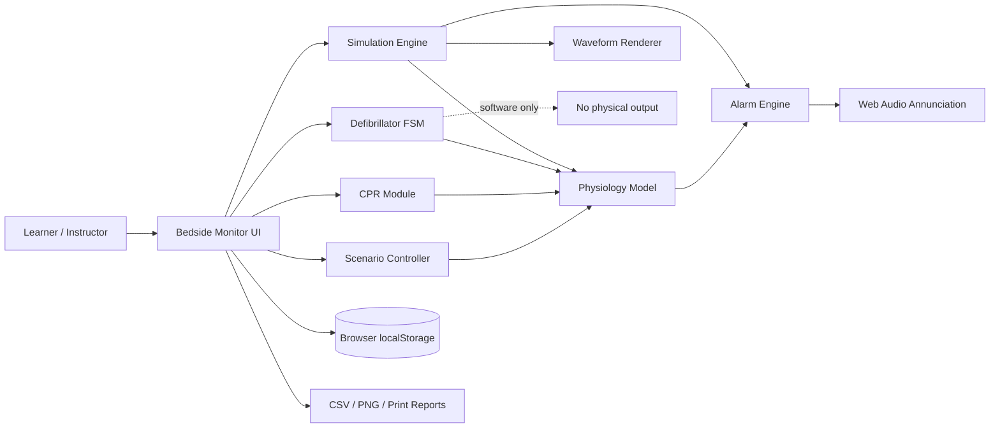

---

## 3. Module map

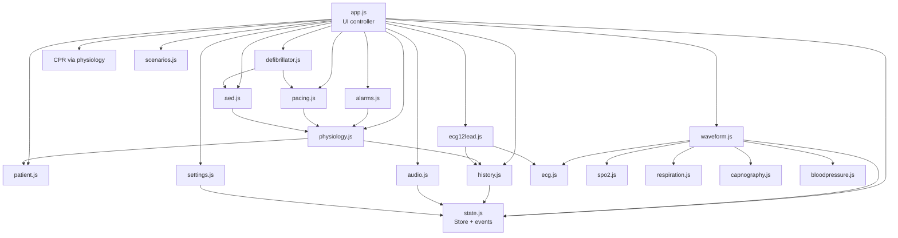

---

## 4. Single simulation loop

`simulation.js` owns the only `requestAnimationFrame` loop. Every frame:

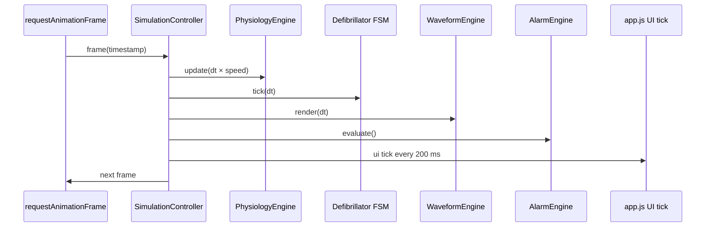

This avoids duplicate animation loops. `ecg12lead.js` renders from the same loop
when its modal is open. Audio uses bounded `setInterval` schedulers, not animation
loops.

---

## 5. State model

`state.js` exposes a singleton `store` with:

- `settings` — persisted user preferences and alarm limits.
- `sim` — live physiological, waveform, device, scenario, CPR, pacing, and alarm
  state.
- `patients` and `activePatientId` — managed by `patient.js`.
- `ui` — transient display flags and modal state.
- `meta` — application identity/version/copyright.

An event bus publishes explicit events such as:

- `simulation:ui-tick`
- `patient:selected`
- `patient:context-applied`
- `rhythm:changed`
- `alarms:changed`
- `defib:changed`
- `cpr:compression`
- `scenario:progression`
- `history:changed`

Modules do not use unrelated global variables. Browser storage is written only
through validated persistence helpers.

---

## 6. Physiology data flow

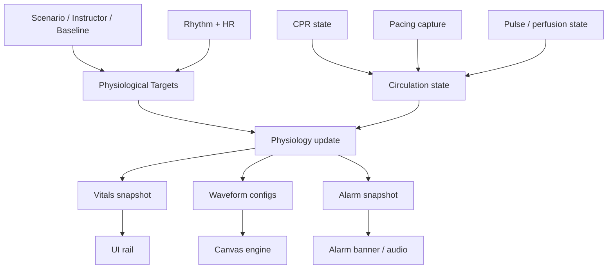

Key invariants:

- VF and asystole force a pulseless, zero-pressure state.
- PEA uses organized electrical activity with an explicitly absent pulse.
- SpO₂ and pulse rate are unavailable when the sensor or pulse state cannot
  support a valid reading.
- A shock may organize the ECG but does not automatically restore circulation.
- ROSC requires an explicit recovery transition with an organized rhythm.

---

## 7. ECG rendering pipeline

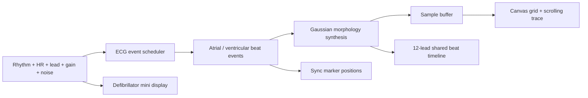

- The ECG source is parameterized, not a static image.
- All 12 leads share a beat timeline but use different approximate lead-vector
  morphology.
- The waveform is educational and not diagnostic.

Other waveform sources:

- Pleth: pulse rate, perfusion, signal quality, respiratory modulation.
- Respiration: rate, depth, pattern, irregularity.
- Capnography: rate, EtCO₂, educational pattern shapes.
- ART/CVP/PA/ICP: pressure-specific waveform synthesis.

---

## 8. Alarm processing flow

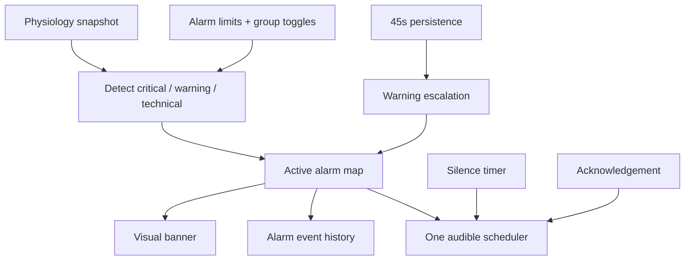

Silence affects sound only. Visual alarms remain active. A single alarm scheduler
selects the highest unacknowledged priority; there is no uncontrolled stacking of
audio loops.

---

## 9. Defibrillator state machine

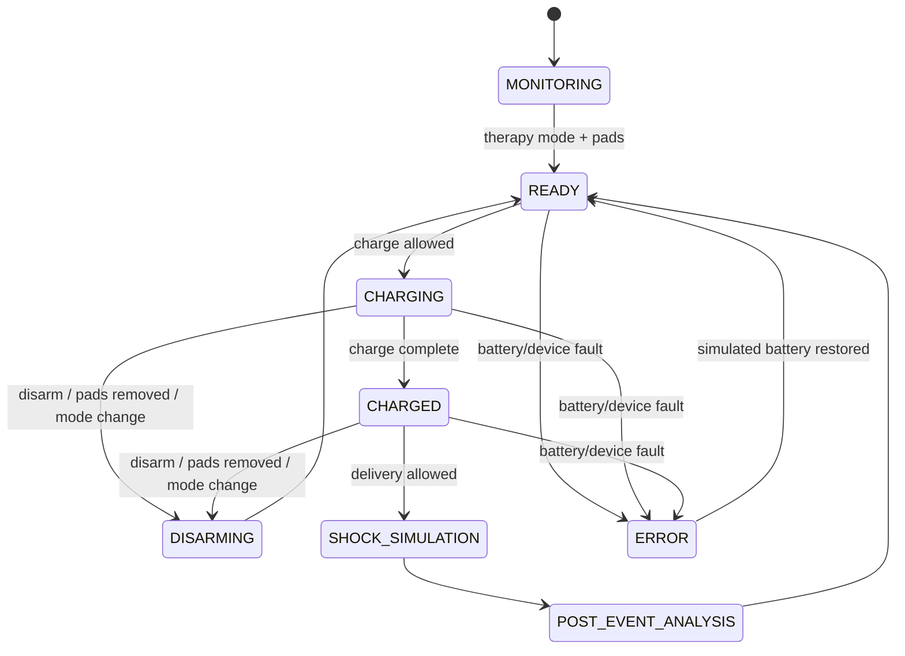

Guards include pads, battery, charge completion, AED recommendation and safety
confirmation, sync eligibility, and pacing separation. No real electrical output
exists.

---

## 10. AED workflow

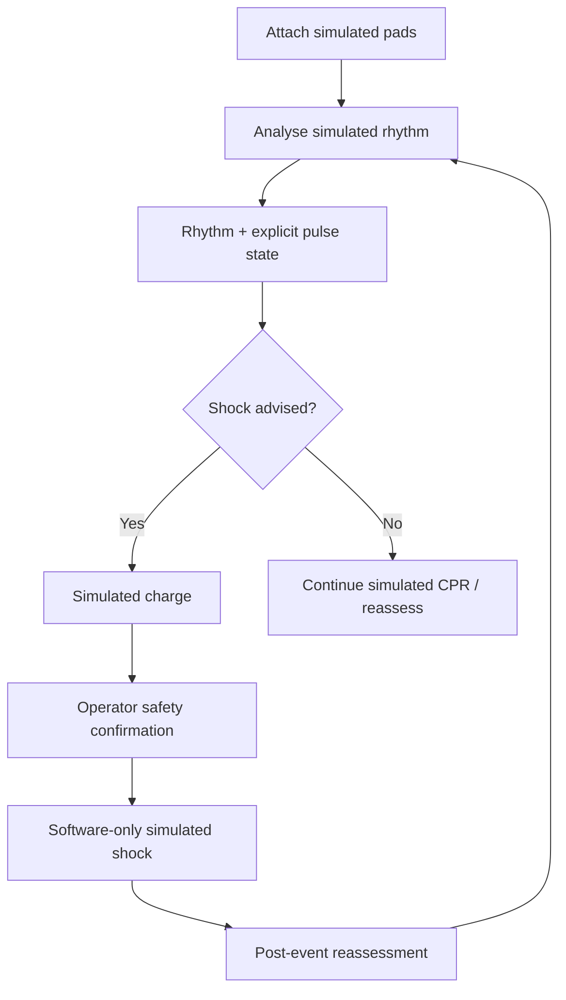

Stable perfusing VT is not treated as an AED shock indication. PEA and asystole
are non-shockable in the educational model.

---

## 11. Scenario workflow

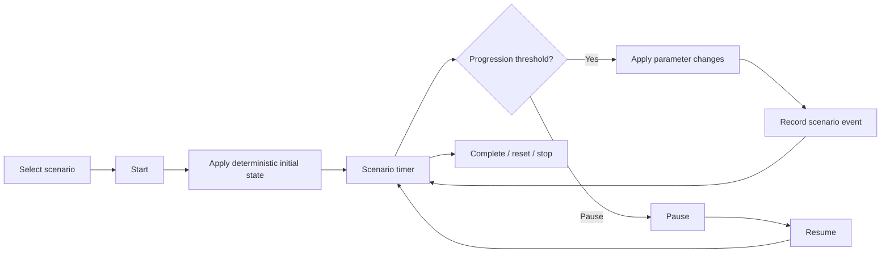

Scenario changes flow through the physiology target engine, so related vitals,
waveforms, and alarms update together.

---

## 12. Persistence

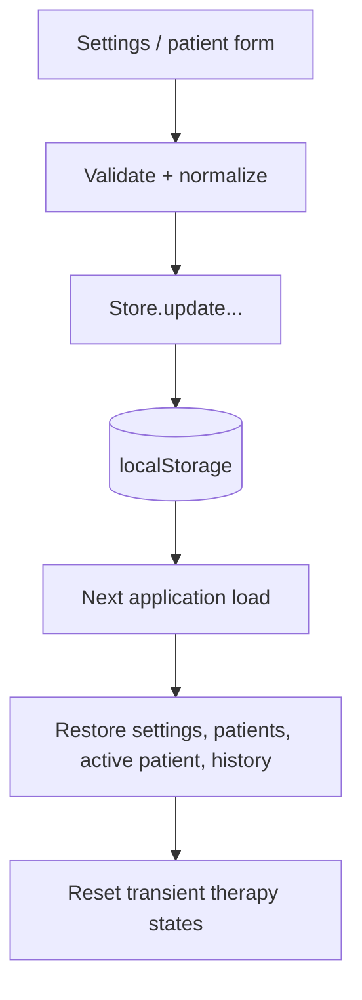

Persisted keys use the `gytech.patientsim.*` namespace. Defibrillator charge,
pacing, sync mode, and active scenario state are intentionally not restored after
reload.

---

## 13. Browser security boundaries

- Static same-origin application.
- Restrictive CSP meta policy and `no-referrer` referrer policy.
- No inline scripts or remote assets.
- User-supplied text escaped before HTML insertion.
- Google-style browser storage only; no encrypted clinical record.
- No backend server, authentication layer, or telemetry.
- Print reports and downloads are local browser outputs.

See [SECURITY.md](../SECURITY.md).

---

## 14. Deliberate limitations

- Not clinically validated.
- Simulated AED/sync/pacing logic is educational.
- Synchronization validates simulated marker eligibility; it is not a real-time
  R-wave-synchronized hardware implementation.
- Pacing failure-to-capture is simplified.
- CPR quality is not measured from sensors.
- No physical device or electrical interface.
- Cross-browser and acoustic behavior require further verification.

---

## 15. Desktop shell

The Electron 34.1.1 desktop shell wraps the same renderer. It does not fork the
simulation modules.

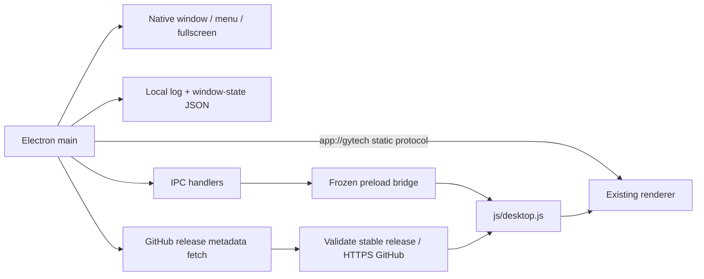

- Main process owns lifecycle, window state, menu, protocol, update fetch, logging,
  permissions, and external-link validation.
- Renderer is sandboxed with context isolation and no Node integration.
- Preload exposes only purpose-specific methods.
- `js/desktop.js` handles About, update notification preferences, local-data
  export/import, and renderer error logging.
- Update fetch occurs in main; the renderer CSP remains `connect-src 'self'`.
- See [DESKTOP_APPLICATION.md](DESKTOP_APPLICATION.md) and
  [UPDATE_SYSTEM.md](UPDATE_SYSTEM.md).

---

Copyright © 2026 GYTech. All Rights Reserved.
