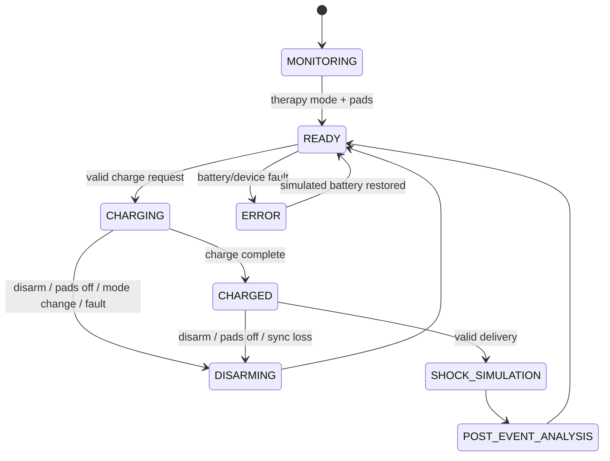
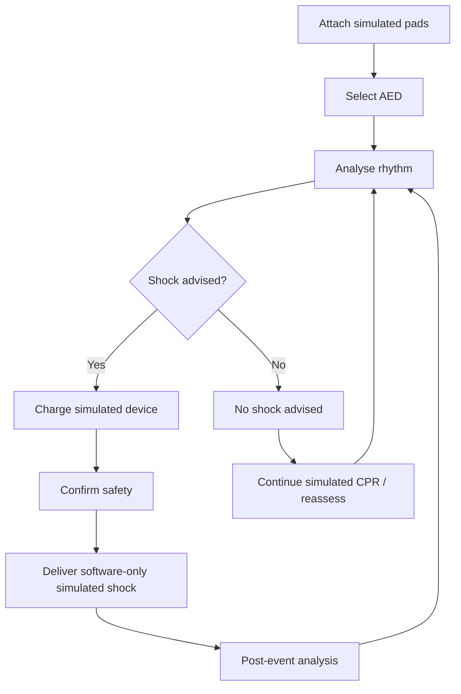

# Defibrillator Simulation Guide

**Copyright 2026 GYTech All Right Reserved.**

> **No real electrical energy is generated.** This is a software-only training
> simulation. Energy values and workflow prompts are educational settings, not
> universal clinical prescriptions. See [DISCLAIMER.md](../DISCLAIMER.md).

---

## 1. Modes

| Mode | Purpose | Therapy behavior |
|---|---|---|
| MONITOR | Display ECG and device readiness | No therapy output |
| MANUAL | Simulated unsynchronized defibrillation workflow | Charge/shock simulation when pads and battery permit |
| AED | Guided rhythm analysis and simulated shock/no-shock recommendation | Charge only after shock-advised analysis; safety confirmation required |
| SYNC | Simulated synchronized cardioversion | Charge/shock gated by valid simulated sync eligibility and markers |
| PACING | Transcutaneous pacing simulation | Independent rate/output controls; not a defibrillation charge |

Mode changes automatically disarm an existing simulated charge where allowed,
disable sync when leaving SYNC, and stop pacing when leaving PACING or
disconnecting pads.

---

## 2. State machine

The FSM implementation is in `js/defibrillator.js`.

### Safety interlocks

- Pads must be connected to charge or deliver.
- Battery must be above the therapy threshold.
- Shock is unavailable before a completed charge.
- Disconnecting pads during charge/charged state disarms.
- AED charge requires a completed shock-advised analysis.
- AED shock requires explicit safety confirmation.
- AED re-checks the current recommendation before delivery.
- Sync mode requires a valid perfusing rhythm and synchronization eligibility.
- Sync loss disarms a charge.
- Pacing is independent of defibrillation and cannot be represented as a shock.
- A depleted battery prevents pacing, AED analysis, charging, and output.
- Shock or pacing is not claimed to create automatic ROSC.

---

## 3. Manual mode workflow

1. Select **MANUAL**.
2. Confirm simulated pads are connected.
3. Select a simulated energy preset.
4. Select **CHARGE**.
5. Wait for the charge state to reach **CHARGED**.
6. Select **SHOCK** to simulate delivery.
7. Review the post-event analysis and reassess the simulated patient.

If the simulated patient is pulseless or the rhythm is not perfusing, no
automatic recovery occurs. Use CPR, rhythm convert/reassess, and an explicit
configured recovery event where appropriate.

### Disarming

Use **DISARM** to cancel a simulated charge. Mode changes, pad disconnection,
battery faults, or loss of sync can also disarm.

---

## 4. AED workflow

The analysis duration is approximately 4.2 seconds. The application may use
browser speech synthesis for optional voice prompts when available.

### Rhythm classification

The educational classifier uses the configured rhythm **and** explicit pulse
state:

- Shockable arrest: VF, or pulseless VT.
- Non-shockable: asystole, PEA, organized perfusing rhythms.
- Stable perfusing VT is not an AED shock recommendation.
- PEA is not diagnosed from ECG morphology alone; the model requires an
  explicitly pulseless state.

A shock may organize the ECG after VF without creating ROSC.

---

## 5. Synchronized cardioversion

SYNC mode:

- Arms synchronization only in SYNC mode.
- Displays simulated R-wave markers from the shared ECG beat timeline.
- Blocks charge without valid simulated sync eligibility.
- Disarms if synchronization is lost.
- Keeps synchronized and unsynchronized workflows separate.

**Important limitation:** the simulator validates simulated sync eligibility and
markers; it does not provide hardware-timed R-wave delivery. An immediate
software shock is issued after eligibility is confirmed. This is a training
model, not a real cardioversion device.

---

## 6. Transcutaneous pacing

Controls:

- Rate (ppm).
- Output (mA).
- Start/stop pacing.
- Electrical capture status.
- Mechanical capture status.

Capture thresholds are model parameters. Electrical capture and simulated
mechanical capture are shown separately. Low output below the threshold
demonstrates failure to capture. Pacing is independent of defibrillation, and the
simulation does not claim an actual electrical stimulus or physical capture.

### Failure-to-capture limitation

When pacing does not capture, the model displays pacer behavior without a full
superimposed intrinsic rhythm. This is an educational simplification and is listed
in the roadmap.

---

## 7. Battery and self-test

The simulated battery can be adjusted in **SETTINGS**. Very low battery triggers
a technical alarm; a depleted battery puts the device into ERROR and blocks
therapy. **SELF-TEST** in the defibrillator panel reports simulated readiness
findings.

---

## 8. Event and post-event review

The defibrillator records mode changes, pad connection, charging, disarming,
shocks, sync changes, pacing events, and safety-related refusals in the simulation
event history. Post-event analysis is a visual/software phase; it is not a
clinical diagnostic interpretation.

---

## 9. Absolute safety boundaries

- No real electrical output.
- No connection to a physical defibrillator, pacemaker, monitor, or hospital network.
- No real patient data.
- No claim of clinical effectiveness.
- No regulatory approval.
- Not a substitute for certified training.

---

Copyright 2026 GYTech All Right Reserved.
